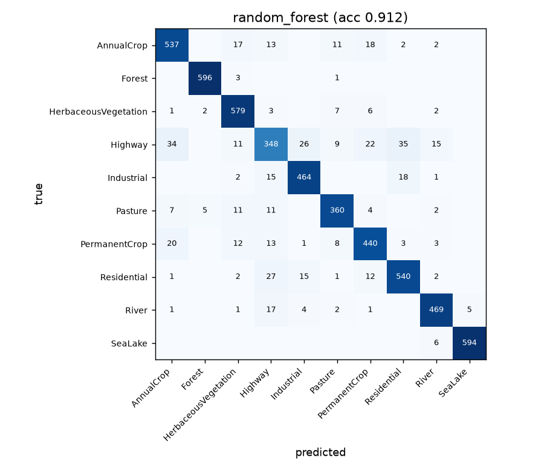
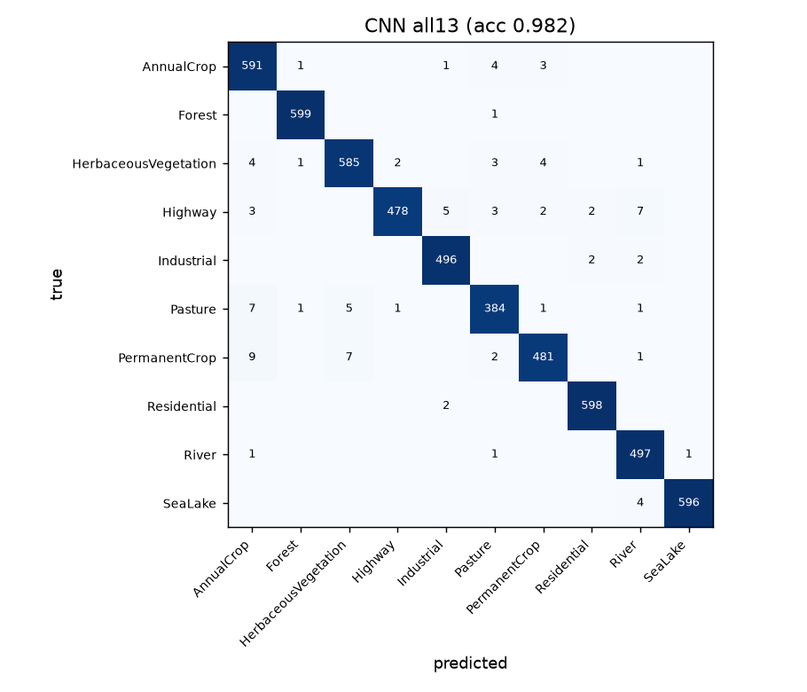
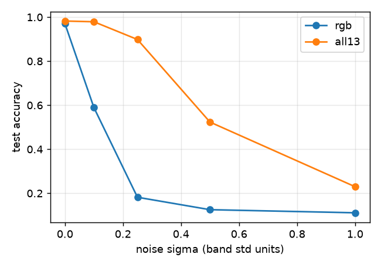
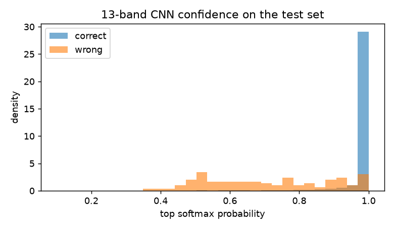
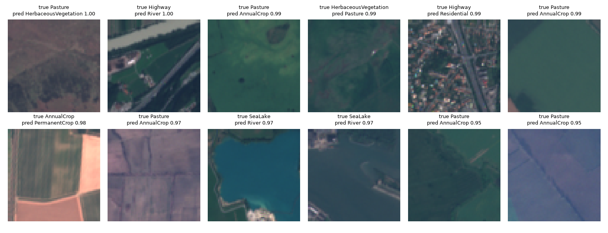
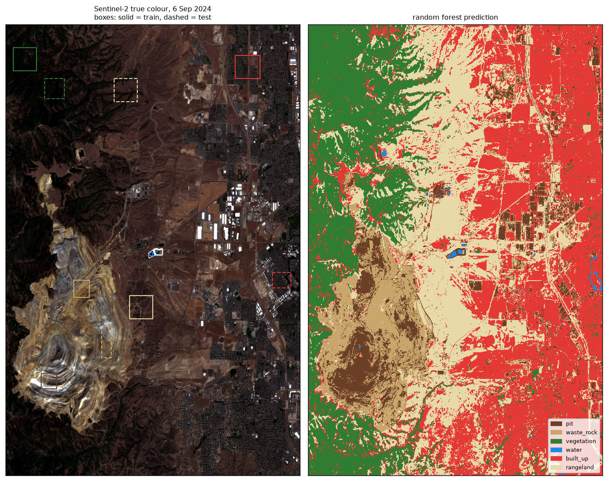
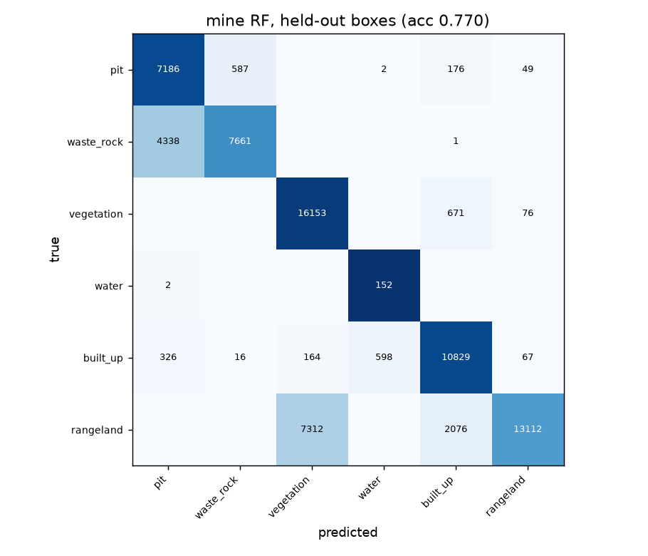

# How well do simple models classify Sentinel-2 imagery, and where do they fail?

Two parts:

1. Land cover classification on EuroSAT (13-band Sentinel-2 patches), comparing a random forest, logistic regression and a small CNN, then breaking the CNN on purpose to see where it fails.
2. A small case study on one open-pit mine (Bingham Canyon, Utah) using one Sentinel-2 scene and labels I drew myself.

The mine part is a small demo. It is not a mining product and it should not be used to measure anything real at the site.

## Data

| Data | Source | Licence |
|---|---|---|
| EuroSAT_MS (13 bands, 27,000 patches, 64x64 px, 10 classes) | Helber et al. 2019, [Zenodo record 7711810](https://zenodo.org/records/7711810) | MIT (checked on the Zenodo record) |
| Sentinel-2 L2A scene `S2B_MSIL2A_20240906T181919_R127_T12TVK_20240907T002550`, 6 Sep 2024, cloud cover 0.0003% | Microsoft Planetary Computer, collection `sentinel-2-l2a` | Copernicus Sentinel data, free and open |

Sentinel-2 bands, briefly: B02/B03/B04 are blue, green, red (10 m). B05/B06/B07/B8A are red edge (20 m), which change a lot with plant health. B08 is near infrared (10 m), where healthy plants are very bright and water is very dark. B11/B12 are shortwave infrared (20 m), which react to moisture and to different rock and soil types. B01, B09 and B10 (60 m) are mostly for the atmosphere (aerosols, water vapour, cirrus cloud) and are not meant to describe the ground.

## Method

**Split.** One stratified 80/20 split (seed 0) used for every EuroSAT model: 21,600 train, 5,400 test.

**Baseline features** (32 per patch): mean and std of each of the 13 bands, plus mean and std of three indices:

- NDVI = (B08 - B04) / (B08 + B04), vegetation
- NDWI = (B03 - B08) / (B03 + B08), open water
- NDBI = (B11 - B08) / (B11 + B08), built-up and bare ground

Models: logistic regression (standardised features) and a random forest (300 trees).

**CNN.** Three conv blocks (32, 64, 128 filters, each two 3x3 convs with batch norm), global average pooling, dropout, linear layer. About 290k weights. Adam, lr 1e-3, cosine schedule, 12 epochs, batch 64, random flips. Each band is normalised with the mean and std from the training set. The RGB and 13-band versions are identical apart from the number of input channels. Trained on CPU, about 6 to 7 minutes per epoch.

**Failure tests** on the trained CNNs, using the same test set:

- Band knock-out: set a group of bands to the training mean (0 after normalising) and measure accuracy. The model is not retrained.
- Noise: add Gaussian noise to every pixel, with sigma given in units of each band's std.
- Confidence: compare the top softmax probability on correct and wrong predictions.

**Mine case study.** I clipped a 19 x 29 km area around the pit, with 10 bands (B10 is not in L2A, and I left out B01 and B09). The 20 m bands were resampled to 10 m. Then I drew rectangles on a contrast-stretched true colour image for six classes: pit, waste rock, vegetation, water, built-up, and rangeland. I added rangeland because most of the scene is dry grass and scrub hills, and without a class for it every one of those pixels would be forced into one of the other five. Each class has one training box and a separate test box in a different part of the scene, so the test score is not just measuring pixels right next to the training ones. The random forest (200 trees, balanced class weights) uses the 10 bands plus NDVI, NDWI and NDBI per pixel, with at most 4,000 training pixels per class.

The boxes are in `data/mine/labels.geojson` (UTM 12N) and open in QGIS. I did not draw them in QGIS. I picked pixel corners off a gridded image (see `src/make_labels.py`).

## Results: EuroSAT

| Model | Input | Test accuracy |
|---|---|---|
| Logistic regression | 32 hand-made features | 0.904 |
| Random forest | 32 hand-made features | 0.912 |
| Small CNN | RGB only (3 bands) | 0.971 |
| Small CNN | all 13 bands | 0.982 |

Per-class recall:

| Class | RF | CNN RGB | CNN 13 bands |
|---|---|---|---|
| AnnualCrop | 0.895 | 0.960 | 0.985 |
| Forest | 0.993 | 0.990 | 0.998 |
| HerbaceousVegetation | 0.965 | 0.962 | 0.975 |
| Highway | 0.696 | 0.962 | 0.956 |
| Industrial | 0.928 | 0.986 | 0.992 |
| Pasture | 0.900 | 0.958 | 0.960 |
| PermanentCrop | 0.880 | 0.942 | 0.962 |
| Residential | 0.900 | 0.993 | 0.997 |
| River | 0.938 | 0.954 | 0.994 |
| SeaLake | 0.990 | 0.988 | 0.993 |

Random forest confusion matrix:



13-band CNN confusion matrix:



What I see in these numbers:

- Highway is the hardest class for the feature models (recall 0.70). Band means can't see a thin road. A highway patch is mostly whatever land is around the road, so it gets called AnnualCrop, Residential or Industrial. The CNN can see the shape, and Highway recall goes up to 0.96.
- The extra bands help, but only a little at this level: 97.1% to 98.2%, roughly 60 fewer wrong patches out of 5,400. The biggest gains are River (0.954 to 0.994) and AnnualCrop and PermanentCrop, where NIR and SWIR separate water and different crops better than colour does. Highway is the only class that did not improve.
- I only ran each model once with one seed, so differences under about half a percent could just be noise between runs.

## Results: failure tests

Band knock-out on the 13-band CNN:

| Bands removed | Accuracy |
|---|---|
| none | 0.982 |
| B01, B09, B10 (atmosphere bands) | 0.794 |
| B05, B06, B07 (red edge) | 0.799 |
| B08, B8A (NIR) | 0.599 |
| B11, B12 (SWIR) | 0.621 |
| B02, B03, B04 (visible) | 0.448 |

- Without NIR, SeaLake recall drops from 0.99 to 0.01 and River from 0.99 to 0.04. The model finds water mostly by how dark it is in NIR.
- Without SWIR, Forest drops to 0.11.
- Removing the three atmosphere bands costs 19 points, even though those bands should not say much about land cover. My guess is that the model picked up a shortcut. For example, those bands could differ between the places and dates where each class was collected. I have not checked this. A fairer test would be to retrain without those bands rather than blank them, because a blanked band is also an input the model never saw in training.

Noise (sigma in band-std units):

| sigma | CNN RGB | CNN 13 bands |
|---|---|---|
| 0 | 0.971 | 0.982 |
| 0.1 | 0.589 | 0.979 |
| 0.25 | 0.182 | 0.899 |
| 0.5 | 0.125 | 0.523 |
| 1.0 | 0.111 | 0.230 |



The RGB model falls apart with a small amount of noise, and it calls almost everything Residential (Residential recall stays at 1.0 while the rest go to 0). I think pixel noise looks like the fine speckled texture of houses and roofs, and with only 3 bands there is nothing else to go on. With 13 bands the same noise per band gets partly averaged out, and the spectral shape still points to the right class. This was the clearest difference between RGB and 13 bands in the whole project, much bigger than the 1 point gap on clean data.

Confidence on mistakes (13-band CNN, clean test set):

- 95 wrong out of 5,400.
- Median top probability: 0.999 when right, 0.70 when wrong. So low confidence is a useful warning sign.
- But 20% of the mistakes had confidence above 0.9.
- Most common confusions: Pasture vs AnnualCrop, PermanentCrop vs HerbaceousVegetation, Highway vs River.



The 12 most confident mistakes:



Looking at these, a few are arguably not model mistakes. One "Highway" patch is half river, and another is a highway running through houses. EuroSAT gives each patch one label even when it holds two classes. The Pasture vs AnnualCrop ones are flat green or brown fields that I can't tell apart by eye either.

## Results: mine case study

Accuracy on the held-out test boxes: **0.770** (71,554 pixels).

| Class | Precision | Recall | Test pixels |
|---|---|---|---|
| pit | 0.606 | 0.898 | 8,000 |
| waste_rock | 0.927 | 0.638 | 12,000 |
| vegetation | 0.684 | 0.956 | 16,900 |
| water | 0.202 | 0.987 | 154 |
| built_up | 0.787 | 0.902 | 12,000 |
| rangeland | 0.986 | 0.583 | 22,500 |





Where it is wrong:

1. **Built-up is far too big.** The model calls 37% of the scene built-up. Much of that is bare, graded or dry farm land east of the mountains, which looks like roofs and roads in these bands. In the test boxes, 2,076 rangeland pixels went to built-up.
2. **Pit vs waste rock is mixed.** 36% of the waste rock test pixels were called pit. Both are freshly broken rock in the same colours, and both have benches. Per pixel, the spectra are very close. Telling them apart probably needs shape or elevation (the pit is a hole, the dumps are piles), and this model has neither.
3. **Large flat roofs become pit.** The big warehouse roofs in the middle of the scene show up as pit (dark brown on the map).
4. **Water is over-predicted.** Recall is fine, but 598 built-up pixels were called water, mostly dark roofs and shadows. There are only 360 training pixels of water, from one pond, so this class is weak.
5. **Rangeland vs vegetation.** The rangeland test box is near the forest edge and has scrub in it, so 7,312 of those pixels were called vegetation. Part of this is my labelling. That box is not pure rangeland.
6. **My labels could be wrong.** I have never been to this mine and I had no reference map. I placed the pit box on the ring of benches around the bottom of the pit and the waste rock boxes on terraced slopes outside it, but I am not certain where the pit edge ends and the dumps start. The test boxes are also single rectangles, so the 0.77 score depends a lot on where I put them.

## Limitations

- One train/test split and one training run per model. No error bars.
- EuroSAT patches come from Europe and are mostly clean and cloud-free. These scores will not carry over directly to other regions or to full scenes.
- EuroSAT is Level-1C (top of atmosphere). The mine scene is Level-2A (surface reflectance). I did not apply the EuroSAT models to the mine scene for this reason, and also because the classes are different.
- The band knock-out test blanks bands instead of retraining without them, so it measures how much this model depends on a band, not how useful the band is.
- Mine labels are a few rectangles drawn by eye, with no field data. Water has very few pixels.
- The mine model is per pixel and has no idea of shape, texture or height.

## How to run

```bash
pip install -r requirements.txt
```

Download `EuroSAT_MS.zip` from Zenodo (2 GB) and unzip it into `data/raw/`, so you get `data/raw/EuroSAT_MS/<ClassName>/*.tif`. Then, from `src/`:

```bash
python baseline.py
```

```bash
python cnn.py rgb all13
```

```bash
python failure.py
```

```bash
python get_scene.py
```

```bash
python make_labels.py
```

```bash
python mine.py
```

The first run reads all the tif files into `data/cache/X.npy` (about 2.8 GB). `cnn.py` takes about 2.5 hours on a laptop CPU. The trained weights are in `models/`, so `failure.py` and the notebook work without retraining.

`notebooks/walkthrough.ipynb` goes through everything in order and shows all the tables and figures. It loads saved results unless you set `RETRAIN = True`.

## Files

```
src/data.py          load EuroSAT, cache, fixed split
src/features.py      band and index features
src/baseline.py      logistic regression and random forest
src/cnn.py           small CNN, RGB and 13-band
src/failure.py       band knock-out, noise, confidence
src/get_scene.py     download the mine scene from Planetary Computer
src/make_labels.py   label boxes for the mine scene -> GeoJSON
src/mine.py          per-pixel random forest and map
results/             all tables and figures
models/              trained CNN weights
```

## References

- Helber, P., Bischke, B., Dengel, A., Borth, D. (2019). EuroSAT: A Novel Dataset and Deep Learning Benchmark for Land Use and Land Cover Classification. IEEE JSTARS.
- ESA Sentinel-2 User Handbook (band descriptions).
